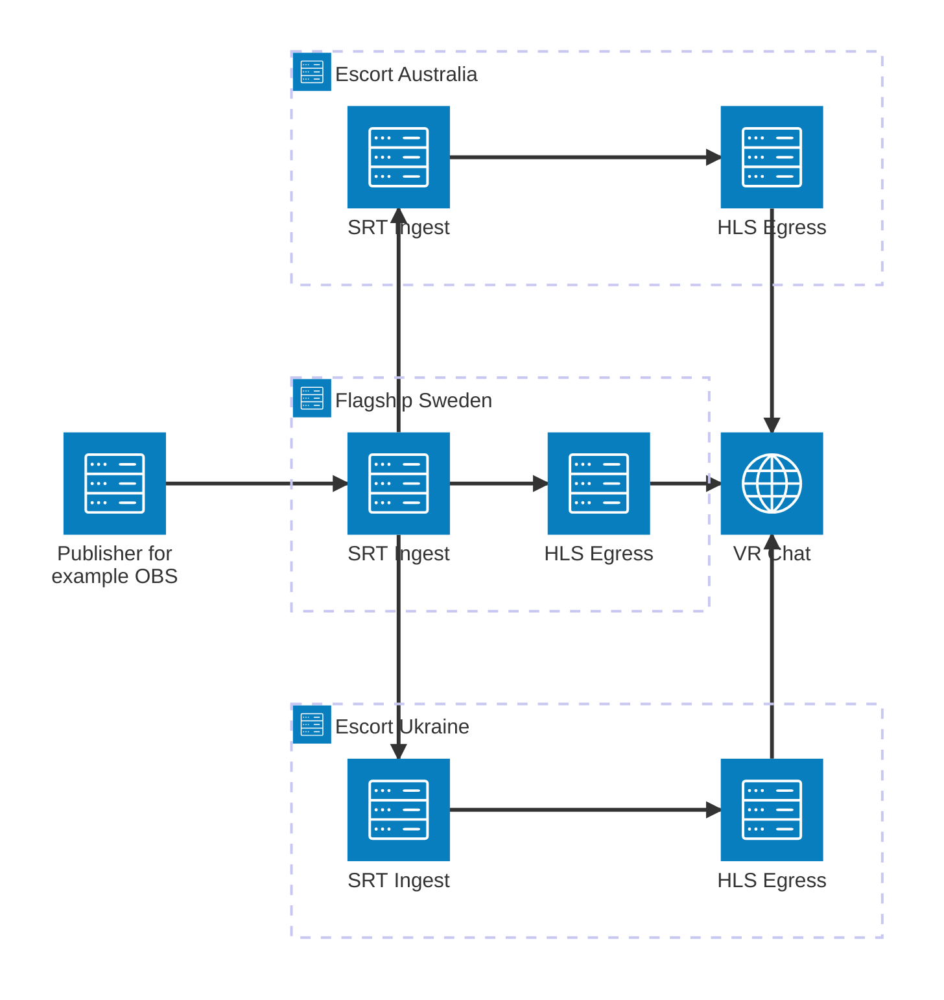

<h1 align="center">VRC-Haven</h1>

<p align="center">
  <i>Very Reliant Content Haven</i> <br> <b>A self-hosted CDN that brings one SRT stream to VRChat viewers over HLS.</b>
</p>

<p align="center">
  <a href="https://github.com/OverlayFox/VRC-Stream-Haven/actions/workflows/go.yml"></a>
</p>

## Table of Contents

- [Table of Contents](#table-of-contents)
- [Introduction](#introduction)
- [Features](#features)
- [Architecture](#architecture)
- [Prerequisites](#prerequisites)
- [Installation](#installation)
  - [Building](#building)
  - [MaxMind Database Setup](#maxmind-database-setup)
- [Configuration](#configuration)
  - [Ports](#ports)
  - [Logging](#logging)
- [Usage](#usage)
  - [Running the Flagship](#running-the-flagship)
  - [Running an Escort](#running-an-escort)
  - [Dashboard](#dashboard)
  - [Docker](#docker)
  - [Deploying Escorts to Linode](#deploying-escorts-to-linode)
- [Development](#development)
- [Roadmap](#roadmap)
- [Contributing](#contributing)
- [License](#license)
- [Acknowledgments](#acknowledgments)

## Introduction

VRC-Haven is a distributed content delivery network for publishing a live stream into VRChat as HLS.
Several servers work together as a "Haven": one flagship takes the stream in, escorts copy it from the flagship, and every viewer is sent to the server closest to them for a more stable stream with less latency.

> ⚠️ **Early Development Notice**: This project is in a pre-alpha stage. Expect bugs and missing features.

## Features

- **Distributed CDN**: Any number of escorts share the viewers of one flagship
- **Geographic Routing**: Viewers are redirected to the nearest escort, or stay on the flagship if it is closer
- **SRT to HLS Remuxing**: Takes an SRT feed and remuxes it to HLS without re-encoding
- **Publisher Reconnects**: Players keep their playlist for 30 seconds while the publisher reconnects
- **Web Dashboard**: Shows the publisher, escorts, redirects and HLS viewers, with a JSON API
- **Lightweight**: A single Go binary per role, the only external dependency is MaxMind's free GeoIP database\*
- **Self-Hosted**: Full control over your streaming infrastructure

> \*The flagship needs MaxMind's GeoLite2-City database, which is free to download. See [MaxMind Database Setup](#maxmind-database-setup).

## Architecture

VRC-Haven uses a hub-and-spoke model with two roles:

- **Flagship**: Receives the stream from the publisher (for example OBS) over SRT, serves it as HLS and redirects viewers to the closest escort.
- **Escort**: Connects to the flagship over SRT, pulls the stream and serves it as HLS to the viewers the flagship sends to it.



Escorts dial out to the flagship, so only their HLS port has to be reachable from the internet.
When a viewer opens the flagship's HLS URL, the flagship looks up the viewer's location and redirects them to the closest escort, or serves them itself.

## Prerequisites

- Linux or Windows
- [Go](https://go.dev/dl/) 1.27 or newer to build the binaries
- Router or firewall access to forward the [ports](#ports)
- A free MaxMind account, for the flagship only

## Installation

### Building

There are no prebuilt releases yet. Build one binary per role:

```bash
go build -o haven-flagship ./cmd/flagship
go build -o haven-escort ./cmd/escort
```

### MaxMind Database Setup

The flagship uses the MaxMind GeoLite2-City database to find out where viewers and escorts are.
It is required for the flagship and free. Escorts don't need it.

1. Create a free account at [MaxMind](https://www.maxmind.com/en/geolite2/signup)
2. Go to the `Manage license keys` page
3. Click `Generate new license key` and give it a name
4. Copy the `Account ID` and `License key`
5. Add both to your `.env`:
   ```
   MAX_MIND_ACCOUNT_ID=YOUR_ACCOUNT_ID_HERE
   MAX_MIND_LICENSE_KEY=YOUR_KEY_HERE
   ```

On startup the flagship downloads the database into `./GeoDatabase` if there is none or the one there is older than 7 days, and deletes older copies.

> **Note**: The database is not included in the repository due to licensing restrictions.

## Configuration

Both binaries read their settings from environment variables, and from a `.env` file in the working directory if there is one. Copy [`.env.example`](.env.example) to get started.

| Variable               | Used by  | Default                       | Meaning                                                                                                    |
| ---------------------- | -------- | ----------------------------- | ---------------------------------------------------------------------------------------------------------- |
| `MAX_MIND_ACCOUNT_ID`  | Flagship | required                      | MaxMind account ID                                                                                         |
| `MAX_MIND_LICENSE_KEY` | Flagship | required                      | MaxMind license key                                                                                        |
| `FLAGSHIP_SRT_ADDR`    | Escort   | `127.0.0.1:8890`              | `host:port` of the flagship's SRT server                                                                   |
| `HAVEN_PASSPHRASE`     | Both     | `thisisaverysecurepassphrase` | SRT encryption passphrase, 10 to 79 characters, escorts must use the flagship's                            |
| `HAVEN_STREAM_ID`      | Both     | `test`                        | Stream ID, escorts must use the flagship's                                                                 |
| `HLS_PORT`             | Escort   | `8555`                        | Port the escort serves HLS on                                                                              |
| `HLS_PUBLIC_ADDR`      | Escort   | `:<HLS_PORT>`                 | `host:port` the flagship redirects viewers to, an empty host means the escort's IP as the flagship sees it |
| `DASHBOARD_PORT`       | Both     | `8080`                        | Port of the [dashboard](#dashboard), ports below 1024 need root or `CAP_NET_BIND_SERVICE`                  |
| `DASHBOARD_USER`       | Both     | empty                         | Basic auth user for the dashboard                                                                          |
| `DASHBOARD_PASSWORD`   | Both     | empty                         | Basic auth password, the dashboard has no auth when this is empty                                          |
| `LOG_LEVEL`            | Both     | `info`                        | See [Logging](#logging)                                                                                    |
| `LOG_FORMAT`           | Both     | text                          | See [Logging](#logging)                                                                                    |
| `PPROF_ADDR`           | Both     | off                           | Serves Go profiles for `go tool pprof` on this address, keep it off public interfaces                      |

### Ports

| Role     | Port | Protocol | Purpose                                |
| -------- | ---- | -------- | -------------------------------------- |
| Flagship | 8890 | UDP      | SRT, for the publisher and the escorts |
| Flagship | 8554 | TCP      | HLS                                    |
| Both     | 8080 | TCP      | Dashboard (`DASHBOARD_PORT`)           |
| Escort   | 8555 | TCP      | HLS (`HLS_PORT`)                       |

### Logging

- `LOG_LEVEL`: `trace`, `debug`, `info` (default), `warn` or `error`
- `LOG_FORMAT`: `json` writes one JSON object per line, anything else writes plain text (colored only on a terminal)

Lines about one HLS player share `client_ip` and `viewer_id`. To follow one player through a log file:

```bash
grep "client_ip=203.0.113.7" haven.log            # every player behind that IP, the "New HLS viewer" line gives their viewer_id
grep "viewer_id=1a2b3c4d" haven.log               # one player's session
jq 'select(.viewer_id == "1a2b3c4d")' haven.log   # the same with LOG_FORMAT=json
```

## Usage

### Running the Flagship

```bash
./haven-flagship
```

Set `HAVEN_PASSPHRASE` and `HAVEN_STREAM_ID` first, the defaults are public. Then point your publisher at the flagship's SRT port. The connection must be encrypted with the passphrase, and the stream ID has the form `publish:<stream id>`. In OBS, for example:

```
srt://<flagship ip>:8890?streamid=publish:<stream id>&passphrase=<passphrase>
```

Only one publisher can be connected at a time. Viewers open this URL, in VRChat for example in a video player:

```
http://<flagship ip>:8554/<stream id>/<passphrase>/index.m3u8
```

### Running an Escort

Set `FLAGSHIP_SRT_ADDR` to the flagship's SRT address and make sure `HAVEN_PASSPHRASE` and `HAVEN_STREAM_ID` match the flagship, then run:

```bash
./haven-escort
```

The escort connects to the flagship and registers the address in `HLS_PUBLIC_ADDR`. Set it when viewers reach the escort under a different address or port than the flagship sees, for example behind NAT or a port mapping.

### Dashboard

Both roles serve a dashboard on `DASHBOARD_PORT` (default 8080), with the same data as JSON at `/api/status`.
The flagship shows its publisher, the connected escorts with their location and SRT stats, how many viewers were redirected to each escort, and its HLS viewers. An escort shows its link to the flagship and its HLS viewers.

Set `DASHBOARD_PASSWORD` (and optionally `DASHBOARD_USER`) to protect it with basic auth.

### Docker

The [`Dockerfile`](Dockerfile) builds either role, picked with the `TARGET` build argument:

```bash
docker build --build-arg TARGET=flagship -t vrc-haven:flagship .
docker build --build-arg TARGET=escort -t vrc-haven:escort .
```

The app only reads `.env` from its working directory, so pass the settings with `-e` or `--env-file`.
The app shuts down on SIGINT, which the image sets as its stop signal.

[`docker-compose.yml`](docker-compose.yml) runs a resource-limited flagship for finding where the haven breaks, see the comments in the file.

### Deploying Escorts to Linode

[`scripts/ansible`](scripts/ansible) creates escorts on Linode for a flagship you already run. You get one escort per region, each on a 2GB shared CPU instance, and every escort connects to your flagship.

1. Install the tools into a virtualenv on your machine. You also need Go installed.
   ```bash
   cd scripts/ansible
   python3 -m venv .venv
   source .venv/bin/activate
   pip install ansible-core linode_api4 polling ansible-specdoc
   ansible-galaxy collection install -r requirements.yml
   ```
   In a new shell, run `source .venv/bin/activate` again before the playbooks.
2. Copy `credentials/example.yml` to `credentials/<linode username>.yml` and fill in the flagship's `HAVEN_PASSPHRASE` and a Linode API token with **Linodes: Read/Write** and **Events: Read Only**. Then encrypt it with `ansible-vault encrypt`.
   Root on the instances gets your local `~/.ssh/id_ed25519.pub`, pass `-e ssh_public_key_file=<path>` for another key.
3. Deploy, giving the regions and the flagship's details:
   ```bash
   ansible-playbook deploy.yml --ask-vault-pass -e linode_user=<linode username> \
     -e escort_regions=au-mel,eu-central \
     -e flagship_ip=<flagship ip> -e flagship_port=8890 -e flagship_application=<flagship's HAVEN_STREAM_ID>
   ```

To remove every escort, run `ansible-playbook destroy.yml --ask-vault-pass -e linode_user=<linode username>`.
For more options, see [`scripts/ansible/README.md`](scripts/ansible/README.md).

## Development

| Command                 | Does                                                            |
| ----------------------- | --------------------------------------------------------------- |
| `make build`            | Builds all packages                                             |
| `make test`             | Runs the tests with the race detector                           |
| `make lint`             | Runs golangci-lint, install it with `make install-dev`          |
| `make performance-test` | Starts the resource-limited flagship from `docker-compose.yml`  |
| `make pprof-web`        | Opens the pprof web UI on a running haven with `PPROF_ADDR` set |
| `make pprof-capture`    | Saves a snapshot of a profile to `.pprof/`                      |
| `make pprof-diff`       | Compares the two newest snapshots                               |

The pprof targets use the heap profile by default, pick another with `PPROF_PROFILE=allocs`, `goroutine`, `profile` (30s CPU) and so on.

Pull requests must update [`CHANGELOG.md`](CHANGELOG.md), the CI checks for it.

## Roadmap

- [x] Proof of Concept
- [x] Code refactoring for improved readability and maintainability
- [x] Better circular buffering
- [x] MPEG-TS Demuxing
- [x] RTSP Muxing
- [x] Move from RTSP to HLS due to VRC not implementing RTSP return codes
- [x] Web interface for monitoring
- [x] Configurable passphrase and stream ID
- [ ] Add UPnP for easier usability by normal users
- [ ] Allow only a certain amount of viewers per node
- [ ] Syncing between SRT-Servers and HLS clients
- [ ] Pirate Mode - allows server to only broadcast the HLS signal on LAN
- [ ] SRT chaining - allows nodes to pull SRT streams from other nodes
- [ ] When an escort disconnects, its viewers should be redirected to a different escort instead of dropped

## Contributing

Contributions are welcome! Feel free to open issues or submit pull requests.

## License

This project is licensed under the terms specified in the [LICENSE](LICENSE) file.

## Acknowledgments

- [MaxMind](https://www.maxmind.com) for providing the geolocation database
