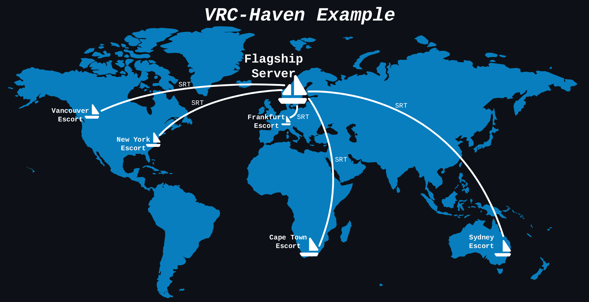

<h1 align="center">VRC-Haven</h1>

<p align="center">
  <i>Very Reliant Content Haven</i> <br> <b>Bring one live stream to VRChat viewers around the world, on servers you control.</b>
</p>

<p align="center">
  <a href="https://github.com/OverlayFox/VRC-Haven/actions/workflows/go.yml"></a>
  <a href="https://github.com/OverlayFox/VRC-Haven/actions/workflows/codeql.yml"></a>
  <a href="https://github.com/OverlayFox/VRC-Haven/actions/workflows/e2e.yml"></a>
  
  <a href="LICENSE"></a>
</p>

## What is VRC-Haven?

VRC-Haven is a self-hosted, multi-server streaming network for VRChat.

You run servers in the regions you choose, and VRC-Haven spreads viewers across them, so each viewer watches from a server close to them.

It fills the same role as [VRCDN](https://vrcdn.live/), but runs entirely on infrastructure you own.

> [!NOTE]
> **VRC-Haven is not affiliated with [VRCDN](https://vrcdn.live/) nor with [VRChat](https://hello.vrchat.com/).<br>
> It's an independent project.**

Everyone uses the **same link** in [VRChat](https://hello.vrchat.com/). <br>
VRC-Haven works out where each viewer is and sends them to the right server, so nobody has to pick one.

<p align="center">
  
</p>

_\*The escorts and flagship are run on servers you own, this project does not provide the infrastructure just the software._

## Is it right for me?

**A good fit if:**

- you run streams or events in VRChat with viewers in different countries
- you want to run the servers yourself
- want an OpenSource, not tracked and no ads option that you 100% own

**Probably not yet if:**

- you want something that works out of the box (yet)

> ⚠️ **Early Development Notice**: This project is in the alpha stage. Expect bugs and missing features.

## Table of Contents

- [What is VRC-Haven?](#what-is-vrc-haven)
- [Is it right for me?](#is-it-right-for-me)
- [Table of Contents](#table-of-contents)
- [Features](#features)
- [Supported Players:](#supported-players)
  - [Video Playback Engines:](#video-playback-engines)
  - [Video Players:](#video-players)
- [Getting Started](#getting-started)
  - [What you need](#what-you-need)
  - [1. Get a free MaxMind license key](#1-get-a-free-maxmind-license-key)
  - [2. Download VRC-Haven and add your settings](#2-download-vrc-haven-and-add-your-settings)
  - [3. Open the ports](#3-open-the-ports)
  - [4. Start the flagship](#4-start-the-flagship)
  - [5. Stream from OBS](#5-stream-from-obs)
  - [6. Share the link](#6-share-the-link)
  - [7. Add escorts (optional)](#7-add-escorts-optional)
  - [Updating](#updating)
- [Dashboard](#dashboard)
- [Deploying Escorts to Linode](#deploying-escorts-to-linode)
- [Debugging](#debugging)
- [Roadmap](#roadmap)
- [AI Disclosure](#ai-disclosure)
- [License](#license)
- [Acknowledgments](#acknowledgments)
  - [GeoLite data](#geolite-data)
  - [Trademarks and affiliation](#trademarks-and-affiliation)
  - [Data protection](#data-protection)

## Features

- **Same link for everyone**: Viewers are sent to the nearest escort, or stay on the flagship if it is closer
- **Your quality stays untouched**: The video is passed along as you sent it and is never re-encoded
- **Survives short drop-outs**: If your stream disconnects, players wait 30 seconds for you to come back
- **Web dashboard**: Shows the publisher, escorts, redirects and viewers, with a JSON API
- **Lightweight**: One small program per server role which uses very little RAM and CPU
- **Self-hosted**: You keep full control over your streaming servers

## Supported Players:

This section shows the current status of support for different players and player engines that are used in VRChat. <br>
[VRChat Player Documentation](https://creators.vrchat.com/worlds/udon/video-players/)

✅ Fully supported | 🟡 Partially Supported | 🚫 Not supported | ⚪ Not yet tested but should work

### Video Playback Engines:

- [](https://github.com/OverlayFox/VRC-Haven/actions/workflows/e2e.yml)
  - Tests the HLS compliance and validates playback via Windows Media Foundation, which is the engine that VRChat uses on Windows

- ⚪ [AV-Pro](https://www.renderheads.com/content/docs/AVProVideo-v3/)
  - AV-Pro uses the Windows Media Foundation to playback the videos
- 🚫 Unity Video Player
  - Not officially supported for [livestreams by VRChat](https://creators.vrchat.com/worlds/udon/video-players/#choosing-avpro-or-unity-video-player), but should play in practice

### Video Players:

- 🟡 [ProTV](https://gitlab.com/techanon/protv)
  - Issue with a resync that can happen every 10 minutes which gets viewers stuck until they manually resync, tracked in [Ticket-#21](https://gitlab.com/techanon/protv/-/work_items/21)
- ⚪ [VideoTXL](https://github.com/vrctxl/VideoTXL)
- ⚪ [USharpVideo](https://github.com/MerlinVR/USharpVideo)
- ⚪ [VizVid](https://github.com/JLChnToZ/VVMW)
- ⚪ [RiskiPlayer](https://github.com/RiskiVR/RiskiPlayer?utm_source=chatgpt.com)
- ⚪ [YamaPlayer](https://github.com/koorimizuw/YamaPlayer)

## Getting Started

### What you need

- A Linux or Windows machine with [Docker](https://docs.docker.com/get-docker/) installed, and access to its router or firewall settings
- A free MaxMind account, set up in [step 1](#1-get-a-free-maxmind-license-key)
- A streaming software like [OBS](https://obsproject.com/)

### 1. Get a free MaxMind license key

This step is only required once for the **Flagship** <br>
Escorts don't need this.

The Database is used to figure out where viewers are in the world to redirect them to the closest escort or flagship.

1. [Sign up for a free GeoLite account](https://www.maxmind.com/en/geolite2/signup) and log in.
2. Open the [license key page](https://www.maxmind.com/en/accounts/current/license-key) and click **Generate new license key**.
3. Write down your **Account ID** and the **License key**. The key is only shown once, so keep it somewhere safe, and treat it like a password.

The flagship downloads the database and keeps it up to date by itself.

### 2. Download VRC-Haven and add your settings

```bash
git clone https://github.com/OverlayFox/VRC-Haven.git
cd VRC-Haven
```

Open [`docker-compose.yml`](docker-compose.yml) and fill in the values marked `change me` under `flagship`:

```yaml
SRT_PASSPHRASE: choose-a-long-passphrase # Needs to be between 10-79 characters
GEO_ACCOUNT_ID: "123456" # Your MaxMind Account ID from Step 1
GEO_LICENSE_KEY: your-license-key # Your MaxMind License Key from Step 1
```

### 3. Open the ports

Forward these on your router, or allow them in your server's firewall:

| Port | Type | Used by              |
| ---- | ---- | -------------------- |
| 8890 | UDP  | OBS and your escorts |
| 8080 | TCP  | Viewers              |

### 4. Start the flagship

```bash
docker compose up -d
```

The first start builds VRC-Haven and downloads the database, so it takes a few minutes. Check on it with `docker compose logs -f`, and stop it with `docker compose down`. It restarts by itself after a reboot.

### 5. Stream from OBS

In OBS, open **Settings → Stream**, set **Service** to **Custom**, leave **Stream Key** empty, and put this in **Server**:

```
srt://<flagship ip>:8890?streamid=publish:ingest&passphrase=<passphrase>
```

In OBS under **Settings → Output**, use H.264 video with a keyframe interval of 1 or 2 seconds (Longer intervals add delay and increase memory usage) and AAC audio.<br>
You can freely choose your bitrate and resolution. <br>
Just remember your viewers need to download and decode the data and if their internet/PC isn't good enough, their stream might stall and stutter.

### 6. Share the link

```
http://<flagship ip>:8080/ingest.m3u8
```

Paste it into a live-stream capable video player in your VRChat world. Viewers need **Allow Untrusted URLs** turned on in their VRChat settings.

### 7. Add escorts (optional)

On each helper server, clone VRC-Haven as in step 2, but fill in the values under `escort` instead. Use the same stream ID and passphrase as the flagship:

```yaml
SRT_PASSPHRASE: insert-the-same-passphrase-as-the-one-in-the-flagship
HAVEN_FLAGSHIP_ADDRESS: <flagship public ip>
```

Open port 8080 TCP, then start it:

```bash
docker compose up -d escort
```

**That's it!** <br>
Viewers near the escort are sent to it automatically, using the same link.

### Updating

```bash
git pull --autostash
docker compose up -d --build        # or: docker compose up -d --build escort
```

`--autostash` keeps the values you filled into `docker-compose.yml`.

## Dashboard

Both roles have a dashboard showing the publisher, escorts, redirects and viewers. Turn it on by filling in the username and password in `docker-compose.yml`, then run `docker compose up -d` again:

```yaml
DASHBOARD_USERNAME: admin
DASHBOARD_PASSWORD: choose-a-password
```

Open `http://127.0.0.1:8090` on that machine, or get the same data as JSON at `/api/status`.

## Deploying Escorts to Linode

[`scripts/ansible`](scripts/ansible) creates escorts on Linode for a flagship you already run. You get one escort per region, each on a 2GB shared CPU instance, and every escort connects to your flagship.

1. Install the tools into a virtualenv on your machine. You also need Go installed.
   ```bash
   cd scripts/ansible
   python3 -m venv .venv
   source .venv/bin/activate
   pip install ansible-core linode_api4 polling ansible-specdoc
   ansible-galaxy collection install -r requirements.yml
   ```
   In a new shell, run `source .venv/bin/activate` again before the playbooks.
2. Copy `credentials/example.yml` to `credentials/<linode username>.yml` and fill in a Linode API token with **Linodes: Read/Write** and **Events: Read Only**, and the flagship's `SRT_PASSPHRASE` as `srt_passphrase`. Then encrypt it with `ansible-vault encrypt`.
   Root on the instances gets your local `~/.ssh/id_ed25519.pub`, pass `-e ssh_public_key_file=<path>` for another key.
3. Deploy, giving the regions and the flagship's details:
   ```bash
   ansible-playbook deploy.yml --ask-vault-pass -e linode_user=<linode username> \
     -e escort_regions=au-mel,eu-central \
     -e haven_flagship_address=<flagship ip> -e srt_stream_id=<flagship's SRT_STREAM_ID>
   ```

The escort settings use the names from [`.env.example`](.env.example) in lower case, so `-e haven_flagship_port=9000` sets `HAVEN_FLAGSHIP_PORT`. Escorts serve viewers on port 8080, like the Docker setup.

To remove every escort, run `ansible-playbook destroy.yml --ask-vault-pass -e linode_user=<linode username>`.
For more options, see [`scripts/ansible/README.md`](scripts/ansible/README.md).

## Debugging

**Logs:** set `LOG_LEVEL` to `trace`, `debug`, `info`, `warn` or `error`, and `LOG_FORMAT=json` for JSON lines. Lines carry `node` and `component`, and lines about one player carry `viewer_id`, so you can search for that ID to follow its whole session.

**Live state:** turn on the [dashboard](#dashboard), or read `/api/status` while you reproduce a problem.

**Profiling:** set `PROFILER_ADDRESS=localhost` and `PROFILER_PORT=6060`, then use the `pprof` commands below. Keep this off public interfaces, because profiles expose stack traces and memory contents. The commands use the heap profile unless you pick another with `PPROF_PROFILE=allocs`, `goroutine`, `profile` (30s CPU) and so on.

## Roadmap

- [x] Proof of Concept
- [x] Code refactoring for improved readability and maintainability
- [x] Better circular buffering
- [x] MPEG-TS Demuxing
- [x] RTSP Muxing
- [x] Move from RTSP to HLS due to VRC not implementing RTSP return codes
- [x] Web interface for monitoring
- [x] Configurable passphrase and stream ID
- [ ] Add UPnP for easier usability by normal users
- [ ] Allow only a certain amount of viewers per node
- [ ] Add Windows frontend
- [ ] Syncing between SRT-Servers and HLS clients
- [ ] Pirate Mode - allows server to only broadcast the HLS signal on LAN
- [ ] SRT chaining - allows nodes to pull SRT streams from other nodes
- [ ] Allow any escort to be promoted to a flagship if no flagship exists yet
- [ ] When an escort disconnects, its viewers should be redirected to a different escort instead of dropped

## AI Disclosure

During the development of VRC-Haven, Claude (Anthropic) was used as an AI-assisted development tool to support code improvements and refactoring, debugging and troubleshooting, writing Go unit tests, and preparing project documentation.

AI-generated suggestions and code were reviewed and understood by the project maintainers before being incorporated into the repository. Changes were validated through Go unit tests, manual testing, static analysis, linting, and automated CI/CD checks.

AI was used exclusively as a development aid. VRC-Haven does not use AI models, AI APIs, or external AI services during runtime.

The project maintainers and contributors remain responsible for the correctness, quality, and maintenance of the codebase.

You can read a more detailed overview in the [AI Disclosure document](AI_DISCLOSURE.md)

## License

VRC-Haven is free software under the [MIT License](LICENSE). It is provided as is, without warranty of any kind.
Nothing in this README or the license limits liability that cannot be limited under applicable law.

VRC-Haven is built on open-source Go libraries listed in [`go.mod`](go.mod). Each one is covered by its own license.

## Acknowledgments

### GeoLite data

This product includes GeoLite Data created by MaxMind, available from [https://www.maxmind.com](https://www.maxmind.com).

VRC-Haven does not ship the GeoLite database. Each server downloads it with the MaxMind account you configure, so you accept the [GeoLite End User License Agreement](https://www.maxmind.com/en/geolite2/eula) yourself and have to follow its terms.

### Trademarks and affiliation

VRC-Haven is an independent project. It is not affiliated with, endorsed by or sponsored by VRChat Inc., [VRCDN](https://vrcdn.live/) or MaxMind, Inc. and it does not represent their views.

VRChat is a trademark of VRChat Inc. MaxMind and GeoLite are trademarks of MaxMind, Inc. Other names belong to their respective owners.
These names are used only to describe what VRC-Haven works with or how it compares.

VRC-Haven does not need VRChat. Any game, platform or player that can play an HLS stream can use it.

### Data protection

Your servers process viewers' IP addresses. They use them to look up an approximate location, show them in the logs (`client_ip`) and use them to tell viewers apart.
Under the EU General Data Protection Regulation (GDPR), IP addresses can be personal data. Whoever runs the servers is the controller for this processing, not the authors of VRC-Haven.

The location lookup runs locally against the downloaded database. VRC-Haven does not send viewer data to its authors or to MaxMind.
If your viewers are in the EU or EEA, decide how long to keep logs and tell viewers how their data is used, for example in your event or world description.
